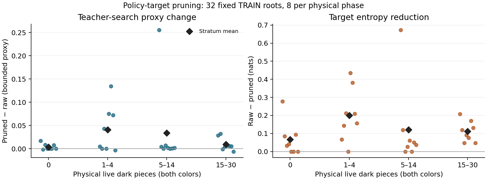

# Separating exploratory search visits from policy training targets

The stronger relative-decoder pretrained actor regresses after its first
ordinary visit/outcome update. Native-terminal reanalysis addresses a measured
return-label mismatch, but policy-target quality is a separate hypothesis.
This study tests the existing upstream pruning heuristic with exact controls;
it introduces no clairvoyant teacher, new hidden information or policy-improvement
theorem.

## Literature and the actual active code path

[KataGo's original paper, section5.3](https://arxiv.org/html/1902.10565v1),
combines forced root exploration with policy-target pruning. It removes some
visits from non-leading actions while their final PUCT urgency stays below the
most-visited action's urgency, and drops residual singleton targets. Its aim is
to explore uncertain alternatives without teaching every exploratory allocation
as a preferred acting policy.

The pinned Yuan source already implements `pruned_policy_from_root`; its ordinary
upstream self-play enables it. It explicitly calls its implementation a bounded
KataGo-inspired heuristic and has no forced playouts. Our replay-certified
generator instead stores actual counts and requires its returned target to equal
those normalized counts, so pruning is disabled there. Enabling the existing
heuristic is therefore a controlled application of an attributed prior method,
not a new pruning algorithm or exact removal of Dirichlet noise.

The original visits remain valuable audit data. A derived training target must
be stored separately; changing a target must never falsify completed search work.

## Frozen physical-phase diagnostic

Select32roots before looking at teacher scores, exclusively from the original
256TRAIN games' admitted native-terminal prefixes. Per physical live-dark stratum
0,1–4,5–14and15–30, choose eight games by a declared SHA256 ordering, then one
root per game by another ordering. The resulting32roots happen to belong to
32distinct games. No selection or strength layout is used. Candidate pools
contain359/1686/5501/6100prefix positions respectively; sampling is deliberately
stratified rather than representative of their natural frequencies.

At each root, run the unchanged pretrained relative actor with256simulations,
LeafBatch32and the original root Dirichlet parameters0.3/0.25. Compare normalized
actual visits against the upstream heuristic applied to that **same** final root.
Verify root statistics remain identical and the new target invents no unvisited
support. The acting move is unchanged. Synthetic tests additionally exercise
tail removal, protection of tied most-visited actions, rejection of incomplete
work and whole-game weighting of the summary.

For an external quality proxy, replay each actor's complete lawful history into
the unchanged native teacher. Include only public mover reveals and that viewer's
own captured-dark observations. Compare complete legal sets; quarantine an
incompatible root without replacement. Each legal action receives a cold-hash
forced2048-node teacher search from that complete history. Define its proxy as
`tanh(cp/860)`, or `sign(mate)`, and compare the two target-weighted proxy means.
Different actions can finish different depths. These bounded scores are neither
calibrated values nor true action regrets, and no teacher scores enter the fit.

All32roots pass full-history/native-mask checks. The primary game-mean
pruned-minus-raw proxy difference is **0.0220036190**, paired game-bootstrap95%
**[0.0074063925,0.0421540136]**,10,000resamples. This supports one separately
controlled learning experiment, not playing-strength promotion.

| Physical live darks | Roots | Mean proxy difference | Raw target entropy | Pruned target entropy |
| --- | ---: | ---: | ---: | ---: |
| 0 | 8 | 0.003937 | 2.287527 | 2.221091 |
| 1–4 | 8 | 0.040757 | 2.463855 | 2.263742 |
| 5–14 | 8 | 0.033865 | 1.822645 | 1.702101 |
| 15–30 | 8 | 0.009456 | 3.090909 | 2.980001 |

The individual-root plot shows that the mean proxy gains include a few much
larger changes. Most roots change less; this is not evidence of a uniform benefit
at every position. The plot and per-phase table are descriptive additions to the
fixed primary mean comparison.

Phase entries are descriptive, without multiple-comparison or phase-interaction
claims. They do not show a monotone relationship between observability and the
benefit of pruning. Physical live-dark count decreases during play, whereas
belief uncertainty about private captured inventories need not do so. Even at
zero live darks, network/search approximation error remains. No phase-dependent
hyperparameter is selected from these eight-root groups.

A preceding four-root8-simulation/64-teacher-node preflight checks transport
and data boundaries only. Its sampled roots are reused in the full diagnostic;
it is not independent evidence. All its actual visits are singleton ties, so
the heuristic leaves those particular targets unchanged; the complete256-work
diagnostic and synthetic tests exercise actual pruning.

Evidence: `results/policy-target-pruning-{preflight,diagnostic,pipeline}-plan.json`
and `results/20261027-policy-target-pruning-{preflight,diagnostic}.json`.

## Exact source-search reconstruction and completed paired fits

The old episode format did not store all final root values and noised priors
needed by the heuristic. Reconstruct each search from its original model, actor
history, environment RNG and continuously advanced per-game search RNG. Every
root-count vector and acting move must exactly match the immutable source record;
every observer record and actual reveal must also agree. Any mismatch aborts,
without silently replacing a root, seed or search result. Stop each derived
episode at its already certified native terminal and verify that terminal again
using the complete public replay API. Original source files are never rewritten.

The three-game integration completes268such roots, including an earlier native
terminal and actual fully public positions;256targets change. It is a reused
subset of the full288-game transform, not an independent benefit estimate.
All288games/15,331prefix roots now reproduce exactly. Separate pruned targets
change14,681roots; mean target entropy changes2.950775→2.837665nats. These are
target statistics, not an improvement in expected game return.

After complete data validation, both fits use the same13,646TRAIN and
1685selection positions, native returns, pretrained parent, minibatch/mirror
streams and optimizer arithmetic. Use one seed20261031, four epochs/batch128/
lr1e-5,428updates and fixed final epoch4. First refit raw visit targets through
the new loader and require the exact existing native-prefix model digest
`318325e35e1a49b7418ed4c0514ee5fae9eaafd00596a72659d7811bc8cecd80`.
That exact-reproduction gate passes. The second fit replaces the policy targets with the
separate audited pruned arrays. Observations and native return labels must be
bitwise identical between arms, as verified on both whole splits. Both fits
complete428updates and retain epoch4. The pruned model's NPZ digest is
`d73e7e018e5aa184d5e91affac67d753b811a2eb3885906bf67b683d72b8fb6d`.
Reanalysis and the raw-control gate could fail; the dispatcher never restarts a
failed dependency.

The frozen research protocol's three64-game actual10+0.1screens are running
against raw control, pretrained parent and unchanged native teacher,
at9760001/9761001/9762001. Keep LeafBatch32for neural actors, one CPU thread
each, two concurrent games and a shared inference device. Freeze both model
artifacts before any match; finish all contrasts regardless of scores and retain
native identity/legal/terminal/clock audits. A gain over a regressed control alone
cannot establish progress against strong baselines.

The teacher proxy justified this bounded test. It supplies no equilibrium
guarantee, validation of approximate future search dynamics, independent
generalization result or completed playing-strength evidence.

Evidence: `results/pruned-native-prefix-research-protocol.json`,
`results/20261027-pruned-native-prefix-preflight.json`,
`results/pruned-native-prefix-{preflight,reanalysis}-plan.json`,
`results/pruned-native-prefix-reanalysis-pipeline-plan.json` and
`results/pruned-native-policy-training-{recipe,queue-plan}.json`.
Completed full data/fit evidence:
`results/20261027-pruned-native-prefix-targets.json`,
`results/20261027-pruned-native-policy-data-preflight.json`,
`results/20261027-pruned-native-policy-{raw-control,upstream-heuristic-pruned}-training.json`
and `results/pruned-native-policy-evaluation-plan.json`.

The frozen experiment retains its original runtime archive digest. The
publication copy removes owner/group/time headers while preserving all576numeric
array/sidecar payloads byte for byte. Its member hashes and archive digest are in
`results/20261027-pruned-native-prefix-public-archive.json`; the downloadable copy
is `results/raw/pruned-native-prefix-targets-public.tar.gz`. Packaging changes
neither training data nor the frozen runtime provenance.
