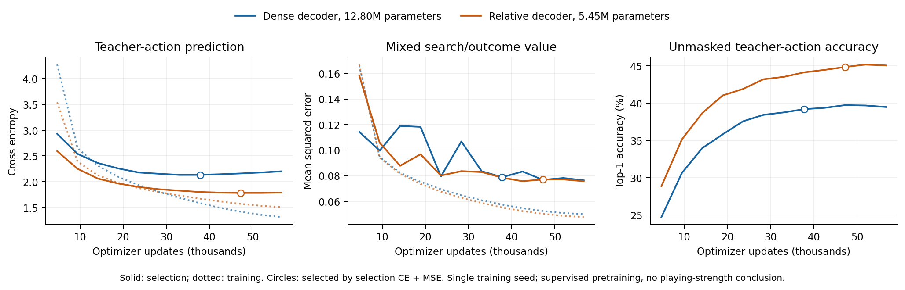

# Wider shared backbone with a relative-action policy decoder

Repeated small neural policy/value updates have not established a gain over
the original warm actor or unchanged native teacher. The next architectural
hypothesis concerns statistical efficiency: the existing final policy
classifier alone contains7,346,550of9,335,543parameters,78.69%of the64x15model.
It assigns separate dense weights to each absolute action.

[Leela Chess Zero's documented convolutional policy format](https://lczero.org/dev/backend/nn/)
computes spatial action planes and gathers its action vector. We independently
adapt that established design principle to the pinned Jieqi geometry; this is
not an implementation of Lc0, a new RL theorem or proof that fewer parameters
play better. [AlphaZero](https://arxiv.org/html/1712.01815v1) also distinguishes
game-specific state/action encodings and warns that chess-like rules do not
justify assuming all board symmetries.

## Exact geometry; unchanged partial observation

The existing2,550geometric actions use50distinct relative displacements:
34orthogonal ray steps, eight knight jumps, four two-step diagonals and four
one-step diagonals. Each action maps uniquely to its origin square and one
relative plane. A1x1convolution maps the existing32policy features to50planes
on the10x9board, then gathers the same2,550logits **before** normalization.
Unused/off-board plane cells do not enter the policy distribution.

This shares a classifier across origins; it does not assert that translating
a real game preserves palace, river or dark-home rules. Actual legal actions
still come from the unchanged full-history search/rule code. Dark pieces keep
their fake movement geometry until moved. The encoder still includes only the
public board, actor-known inventories and counter, with irrelevant inventories
canonicalized only at actual both-dark-zero. No true dark identity, opponent
private capture or unavailable history feature is introduced. The mapping
is unchanged as pieces reveal; the same decoder covers partial and public play.

Three tests check all2,550unique mappings and gradient support, commutation of
the codec with coordinate reflections, identical common initial arrays/value
outputs and safe numeric NPZ roundtrip/mapping-digest rejection. Codec symmetry
does not claim network equivariance or game-rule symmetry. The new loader also
accepts the old dense format; the old loader cannot silently interpret relative
head arrays as dense parameters.

## Matched capacity and initialization

| Model | Residual body | Total parameters | Final classifier parameters |
| --- | --- | ---: | ---: |
| Existing warm reference | 64channels,15blocks | 9,335,543 | 7,346,550 |
| New dense control | 128channels,15blocks | 12,798,455 | 7,346,550 |
| New relative decoder | 128channels,15blocks | 5,453,555 | 1,650 |

The new pair has the same wider residual body, policy-feature convolution/BN,
ordinary value head and all202shared initial state arrays. Initial value
outputs agree exactly on64TRAIN records; initial policy functions deliberately
differ. Both are cold initialized from one seed, rather than function-preserving
copies of warm. Thus the new-pair comparison changes only the decoder, whereas
comparison with the old warm model also changes body capacity and training
initialization. Lower total parameter count does not imply less body compute.
Both arms have `phase_experts=false`; no public-only second value head is enabled.

## Full replay and fixed GPU budget

Use the same four certified teacher-search replay files as the original warm
study:32,768generated games,32,767with searched records and2,417,541positions.
The certified zero-search game is retained as such; random-prefix actions are
not invented. Use the same512selection games/37,471positions. Preserve original
one-hot actual teacher moves and0.7*tanh(score/860)+0.3terminal-return value
targets. This is supervised search-action pretraining, not newly generated
current-model self-play RL.

Each arm uses one seed20261029,12epochs, batch512 and56,652updates. Keep
AdamWlr0.0003/weight decay0.0001, clip1,5%warmup/cosine schedule, horizontal
mirror draws and BF16autocast when supported. The same dedicated RNG stream
orders examples/augmentation. Both complete all12epochs and independently
select the minimum common selection CE+MSE, excluding initialization. There is
no early stopping, match-based checkpoint choice or between-arm retuning.
Two separate single-GPU runs execute in parallel, apart from active timed-match
GPUs; this is not distributed training, equal FLOP cost or multiple training seeds.

Before full fitting, both tiny8-channel/one-block variants complete one GPU
epoch/11updates on357rows from four TRAIN games, with145rows from two other
TRAIN games used only for smoke evaluation. Three fresh UCI actors perform
exactly eight completed simulations: dense legacy and new loaders choose the
same opening move; the relative model also chooses an opening-legal action.
These checks do not establish full-game legality, timed reliability, independent
generalization or chess strength.

## Fixed strength checks after fitting

Freeze selected model hashes before testing:64games for relative versus matched
dense at seed9670001, relative versus old warm at9671001and versus native
teacher at9672001, plus dense versus old warm at9673001and versus teacher
at9674001. Finish all five contrasts regardless of earlier results. Use actual
10+0.1, LeafBatch32for neural actors, one CPU thread each, two concurrent games
and one shared dedicated inference GPU within each campaign. Keep the tagged
safe loader and ordinary observer/search protocol common to the new pair.

Native reveal, legality, terminal and clock audits plus raw archives remain
mandatory. Preserve technical games and timing ambiguities. Parameter savings,
teacher accuracy, proxy loss and a win over a weak control cannot promote a
model. These development screens do not meet the final independent multi-set
>70%strong-suite/report gate.

Evidence: `results/spatial-policy-research-protocol.json`,
`results/20261027-spatial-policy-initialization.json`,
`results/spatial-policy-{dense2550,relative50}-training-plan.json`,
`results/20261027-spatial-policy-actor-integration.json` and
`results/20261027-spatial-policy-integration-{dense2550,relative50}.json`.

The queued evaluator waits for both verified live training controllers to
complete, then binds both selected artifacts before starting any matches. It
requires the complete epoch/update budget, matching replay and selection data,
the prescribed minimum-validation-loss checkpoint, and matching report/model
digests. The relative three-match and dense two-match campaigns run on separate
inference devices after training releases them. All runtime inputs are frozen;
an occupied device or failed dependency stops dispatch without restarting a fit
or overwriting a prior evaluation. Preparation on the completed tiny fits
retains all five planned contrasts/seeds and creates no match outputs. Three
targeted tests also reject incomplete fits, checkpoint reselection and nonfinite
selection losses. This verifies scheduling boundaries, not playing strength.
Evidence: `results/spatial-policy-evaluation-queue-recipe.json` and
`results/20261027-spatial-policy-evaluation-queue-integration.json`.

## Completed full-budget fitting; all five contrasts dispatched

Both128x15arms finish all12epochs and56,652updates. The prescribed common
selection CE+MSE rule chooses dense epoch8and relative epoch10, before the
queued matches start. The selected artifacts are:

| Decoder | Parameters | Selection policy CE | Mixed value MSE | Unmasked teacher top1 |
| --- | ---: | ---: | ---: | ---: |
| Dense2550 | 12,798,455 | 2.133630 | 0.078767 | 39.2037% |
| Relative50 | 5,453,555 | 1.784469 | 0.077051 | 44.8507% |

Dense NPZ: `7e09e0b7e5c74c7aa3f37db518489df4cc36669a830ac54a904bf395dd174795`.
Relative NPZ: `e43ff2aaf276fe8d5700da12c0ca00f1bdd9882f676dc1c51c3ed809dac28c1f`.
These metrics reuse the declared checkpoint-selection set; top1uses all2550
geometric logits before a real legal mask. They do not establish independent
generalization, a playing-strength gain, a pure parameter-count effect or
novelty of the shared convolution/gather principle. In particular, the decoder
intervention changes both parameter count and structure.

The five prespecified64-game contrasts retain their original seeds, clocks,
model-selection rule and eager inference. Both candidate artifacts are frozen
in both generated evaluation plans before the first game. Reports and vector
curves: `results/20261027-spatial-policy-{dense2550,relative50}-training.json`,
`results/spatial-policy-{dense2550,relative50}-evaluation-plan.json` and
`results/figures/spatial_policy_pretraining_20261027.{pdf,json}`.

The first two fixed screens complete with technically clean native/clock audits:

| Contrast | W/D/L | Score | Paired score bootstrap95% | Audited moves |
| --- | --- | ---: | --- | ---: |
| Dense128vs old warm64 | 40/1/23 | 63.28125% | [50%,76.5625%] | 3482 |
| Relative128vs matched dense128 | 38/1/25 | 60.15625% | [48.4375%,71.875%] | 3120 |

Both have zero technical games and rounding ambiguities. Neither interval has
a lower bound strictly above50%, so these favorable point estimates do not yet
establish superiority. The direct relative-versus-warm and both native-teacher
contrasts continue unchanged; do not infer the former transitively from this
table. Evidence uses
`results/20261027-spatial-policy-dense2550-vs-old-warm64x15{,-audit}.json` and
`results/20261027-spatial-policy-relative50-vs-matched-dense128x15{,-audit}.json`.
